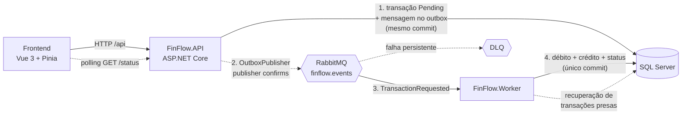
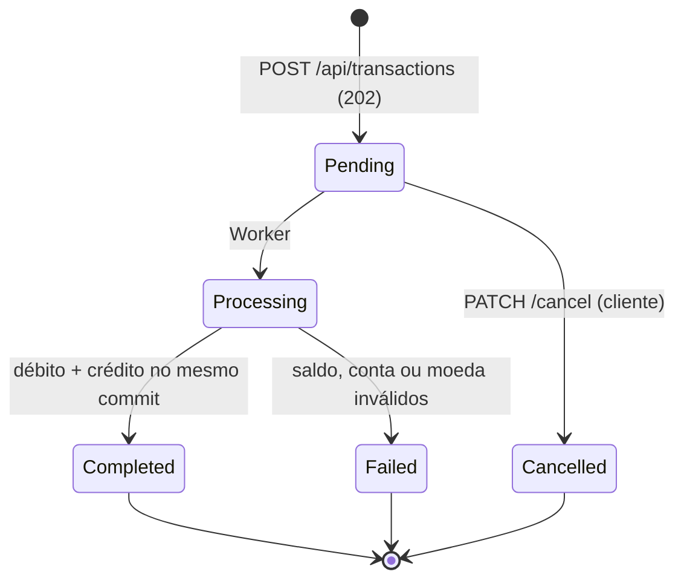

# FinFlow

Plataforma de **transferências bancárias assíncronas** construída com **.NET 10**, **RabbitMQ**, **SQL Server** e **Vue 3**.

A API aceita a transferência na hora (`202 Accepted`) e um **Worker** separado processa débito e crédito em segundo plano.
O foco do projeto é **consistência financeira**: nenhuma mensagem se perde, nenhum valor é movimentado duas vezes e
todo estado na tela reflete o que realmente aconteceu no banco de dados.


---

## Destaques

- **Transactional Outbox**: a transação e o evento `TransactionRequested` são gravados no mesmo commit; um serviço
  em segundo plano publica no RabbitMQ com *publisher confirms*. Se o broker estiver fora, nada se perde.
- **Worker idempotente**: o status da transação é a fonte da verdade. Mensagens duplicadas são ignoradas, e
  débito, crédito, status final e auditoria acontecem num **único commit SQL**.
- **Concorrência sem deadlock**: bloqueio pessimista (`UPDLOCK`) da transação e das contas em **ordem
  determinística**, com `rowversion` como segunda barreira (concorrência otimista).
- **Resiliência**: retry com *backoff* exponencial + *jitter*, orçamentos separados para falhas transitórias e
  persistentes, **Dead Letter Queue** e um serviço de **recuperação de transações presas** em `Pending`/`Processing`.
- **Multimoeda**: transferências entre moedas usam a taxa vigente no momento da criação; taxa e valor convertido
  ficam gravados na transação.
- **Segurança**: ASP.NET Core Identity com cookie `HttpOnly` + `SameSite=Strict`, **RBAC** (Administrator, Treasurer,
  Customer), bloqueio de conta, *rate limiting* no login e troca de senha obrigatória no primeiro acesso.
- **Trilha de auditoria** de operações sensíveis, gravada na mesma transação da operação auditada.
- **Testes de verdade**: unitários (xUnit + Moq) e de integração/end-to-end com **Testcontainers** (SQL Server e
  RabbitMQ reais), incluindo injeção de falhas e verificação de consistência financeira.

---

## Arquitetura



### Ciclo de vida de uma transferência



Não existe endpoint para alterar o status livremente: ele precisa refletir o que aconteceu com os saldos, e é ele
que garante a idempotência do Worker.

### Clean Architecture

```
src/
  FinFlow.Domain/          Entidades, regras de negócio (FundsTransfer) e exceções de domínio. Sem dependências.
  FinFlow.Application/     Casos de uso, DTOs, validações (FluentValidation) e contratos (repositórios, UoW, outbox).
  FinFlow.Infrastructure/  EF Core + SQL Server, Identity, Outbox, cliente RabbitMQ, repositórios com bloqueio de linha.
  FinFlow.API/             Controllers REST, autenticação/autorização, ProblemDetails, Swagger.
  FinFlow.Worker/          Consumer RabbitMQ, retry, recuperação de transações presas.
  frontend/                SPA Vue 3 + TypeScript + Vite + Tailwind (ver src/frontend/README.md).
tests/
  FinFlow.UnitTests/         Domínio e aplicação (xUnit + Moq).
  FinFlow.IntegrationTests/  API, persistência, Worker e fluxos end-to-end (Testcontainers).
```

### Topologia do RabbitMQ

| Recurso | Tipo | Função |
|---|---|---|
| `finflow.events` | exchange *topic*, durável | Eventos de domínio publicados pelo outbox |
| `finflow.transactions.requested` | fila durável | Consumida pelo Worker (prefetch e concorrência configuráveis) |
| `finflow.events.dlx` | exchange *topic*, durável | *Dead letter exchange* |
| `finflow.transactions.requested.dlq` | fila durável | Mensagens com falha persistente, sem perda |

Mensagens são persistentes e o Worker usa ACK manual: `ack` em sucesso, `nack` com *requeue* em falha transitória
e `nack` sem *requeue* (vai para a DLQ) quando as tentativas se esgotam. Transações que ficarem presas são
retomadas pelo `StuckTransactionRecoveryService`, pelo mesmo caminho do consumer.

---

## Stack

| Camada | Tecnologias |
|---|---|
| Backend | .NET 10, ASP.NET Core, EF Core 10, ASP.NET Core Identity, FluentValidation, Swagger |
| Mensageria | RabbitMQ 4 (RabbitMQ.Client 7) |
| Banco | SQL Server 2022 |
| Frontend | Vue 3, TypeScript, Vite, Pinia, Vue Router, Tailwind CSS 4, Axios |
| Testes | xUnit, Moq, Testcontainers (MsSql e RabbitMq), WebApplicationFactory, Vitest |
| Infra local | Docker Compose |

---

## Como rodar

### Pré-requisitos

- [.NET SDK 10](https://dotnet.microsoft.com/download)
- [Docker](https://www.docker.com/) (infra local e testes de integração)
- [Node.js](https://nodejs.org/) 20+ (frontend)
- Ferramenta do EF Core: `dotnet tool install --global dotnet-ef`

### 1. Infraestrutura (SQL Server + RabbitMQ)

```bash
docker compose up -d
```

Painel do RabbitMQ: <http://localhost:15672> (`finflow` / `finflow_dev`).

### 2. Banco de dados

```bash
dotnet ef database update --project src/FinFlow.Infrastructure --startup-project src/FinFlow.API
```

### 3. API e Worker (em terminais separados)

```bash
dotnet run --project src/FinFlow.API --launch-profile http   # http://localhost:5017/swagger
dotnet run --project src/FinFlow.Worker
```

Sem o Worker rodando, as transferências ficam em `Pending`, e a interface mostra isso.

### 4. Frontend

```bash
cd src/frontend
npm install
npm run dev    # http://localhost:5173
```

### Acesso inicial (somente desenvolvimento)

| Usuário | Senha | Observação |
|---|---|---|
| `admin@finflow.com` | `admin` | A troca de senha é obrigatória no primeiro login |

As credenciais do `docker-compose.yml` e dos `appsettings.Development.json` são **apenas para desenvolvimento local**.

---

## Perfis de acesso

| Perfil | Pode |
|---|---|
| **Administrator** | Tudo, inclusive usuários, perfis, moedas, taxas de câmbio e auditoria |
| **Treasurer** | Consultar todas as contas e transações, transferir, consultar taxas vigentes |
| **Customer** | Abrir e consultar as próprias contas, transferir a partir delas, ver o próprio histórico |

---

## Principais endpoints

A documentação completa está no Swagger (`/swagger`, em desenvolvimento).

| Método | Rota | Descrição |
|---|---|---|
| `POST` | `/api/auth/login` · `/logout` · `/change-password` | Sessão por cookie |
| `GET` | `/api/auth/me` | Usuário autenticado |
| `POST` | `/api/accounts` | Abrir conta |
| `GET` | `/api/accounts` · `/summary` · `/{id}` · `/{id}/balance` · `/{id}/cash-flow` | Contas, saldos e fluxo de caixa |
| `POST` | `/api/transactions/preview` | Simular transferência (inclusive câmbio) |
| `POST` | `/api/transactions` | Criar transferência (`202 Accepted`, status `Pending`) |
| `GET` | `/api/transactions` · `/summary` · `/{id}` · `/{id}/status` | Histórico, contagem por status e acompanhamento |
| `PATCH` | `/api/transactions/{id}/cancel` | Cancelar (somente `Pending`) |
| `GET/POST/PATCH` | `/api/currencies` | Moedas |
| `GET/POST/DELETE` | `/api/exchange-rates` · `/quote` · `/history` | Taxas de câmbio |
| `GET/POST/PATCH` | `/api/admin/users` · `/{id}/reset-password` | Gestão de usuários |
| `GET` | `/api/admin/audit-logs` | Trilha de auditoria |

Listagens são paginadas no servidor (`page`, `pageSize` até 100). Erros seguem o padrão **ProblemDetails**
(RFC 9457), com erros de validação por campo.

---

## Testes

```bash
dotnet test                    # unitários + integração (precisa do Docker rodando)
dotnet test tests/FinFlow.UnitTests

cd src/frontend && npm test    # Vitest
```

Os testes de integração sobem **SQL Server e RabbitMQ reais via Testcontainers** e cobrem:

- endpoints, autenticação, RBAC, paginação e multimoeda;
- fluxo completo de transferência (API → outbox → RabbitMQ → Worker → banco);
- **consistência financeira** sob concorrência (a soma dos saldos se mantém);
- bloqueio de linha e Unit of Work;
- retry, DLQ e recuperação de transações presas, com **injeção de falhas**.

---

## Configuração do Worker

Em `src/FinFlow.Worker/appsettings.json`:

| Chave | Padrão | Descrição |
|---|---|---|
| `Worker:Consumer:MaxConcurrency` | `4` | Mensagens processadas em paralelo |
| `Worker:Consumer:PrefetchCount` | `16` | Prefetch do canal RabbitMQ |
| `Worker:Processing:MaxTransientAttempts` | `6` | Tentativas para falhas transitórias |
| `Worker:Processing:MaxPersistentAttempts` | `3` | Tentativas para falhas não transitórias |
| `Worker:Processing:BaseDelay` / `MaxDelay` | `100ms` / `5s` | Backoff exponencial com jitter |
| `Worker:Recovery:Interval` | `30s` | Frequência da varredura de transações presas |
| `Worker:Recovery:StaleAfter` | `2min` | Tempo para considerar uma transação presa em `Processing` |
| `Worker:Recovery:PendingStaleAfter` | `10min` | Tempo para considerar uma transação presa em `Pending` |

---

## Autor

**Vitor Leonardo**: [LinkedIn](https://www.linkedin.com/in/SEU-PERFIL) · [GitHub](https://github.com/SEU-USUARIO)
